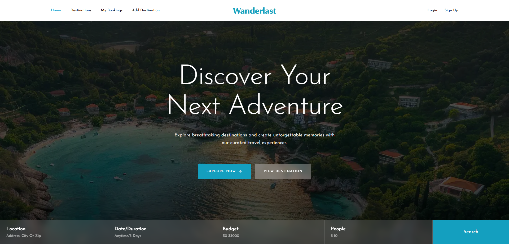

<div align="center">

# 🌍 Wanderlust

### Discover Your Next Adventure

**A Modern Full-Stack Travel Booking Platform**

Explore beautiful destinations, book your dream trips, and manage your travel experiences with Wanderlust.

[](https://wanderlust-frontend-ruddy.vercel.app/)

[](https://nextjs.org)
[](https://react.dev)
[](https://www.typescriptlang.org)
[](https://tailwindcss.com)
[](https://better-auth.com)
[](https://www.mongodb.com)

**Frontend:** [GitHub Repository](https://github.com/riyad-devx/wanderlust-travel)

**Backend:** [GitHub Repository](https://github.com/riyad-devx/wanderlust-backend)

</div>

---

## 📸 Project Preview



---

## ✨ Overview

Wanderlust is a modern, full-stack travel booking platform built with the **Next.js App Router**.

It allows users to explore beautiful travel destinations, discover travel packages, book trips, and manage their bookings. Users can also publish their own destinations and manage their listings.

The application uses **Better Auth** for authentication and a separate **Express.js + MongoDB** backend for managing destinations and bookings. Secure communication between the frontend and backend is handled through JWT authentication.

## 🚀 Features

- 🏝️ **Featured Destinations** — Explore handpicked travel destinations on the homepage.
- 🔎 **Destination Explorer** — Browse all available destinations with filtering and sorting.
- 📄 **Destination Details** — View complete destination information, highlights, ratings, and booking options.
- ➕ **Add Destination** — Publish new travel destinations with images and details.
- ✏️ **Edit Destination** — Update your own destination listings.
- 🗑️ **Delete Destination** — Remove destinations you own.
- 🧾 **My Bookings** — View and manage your booked trips.
- ❌ **Cancel Booking** — Cancel your upcoming bookings.
- 🔐 **Authentication** — Secure signup, login, and session management.
- 🛡️ **Protected Routes** — Restrict private pages to authenticated users.
- 🔑 **JWT Security** — Secure API requests using Better Auth JWT.
- 📱 **Responsive Design** — Mobile-first interface for desktop, tablet, and mobile devices.

## 🛠️ Technology Stack

### Frontend

| Technology | Purpose |
|---|---|
| Next.js 16 | React framework |
| React 19 | UI development |
| TypeScript | Type safety |
| Tailwind CSS v4 | Styling |
| shadcn/ui | UI components |
| Lucide React | Icons |
| Better Auth | Authentication |

### Backend

| Technology | Purpose |
|---|---|
| Node.js | JavaScript runtime |
| Express.js 5 | REST API |
| MongoDB | Database |
| Better Auth JWT | API authentication |
| JWKS | JWT verification |

## 🧭 Application Pages

| Route | Description | Access |
|---|---|---|
| `/` | Homepage with banner, featured destinations, testimonials, and CTA | Public |
| `/destinations` | Browse all destinations with filters and sorting | Public |
| `/destinations/[id]` | Destination details, booking, edit, and delete | Public / Protected actions |
| `/add-destination` | Add a new destination | Protected |
| `/my-bookings` | View and manage bookings | Protected |
| `/login` | User login | Public |
| `/signup` | User registration | Public |

## 🔐 Authentication & Security

Wanderlust uses **Better Auth** with MongoDB and the JWT plugin to provide secure authentication.

### Authentication Workflow

1. Users register or log in using Better Auth.
2. Better Auth manages user sessions securely.
3. The frontend requests a short-lived JWT from `/api/auth/token`.
4. The `authFetch` helper attaches the JWT to backend API requests.
5. The Express backend receives the token through the `Authorization` header.
6. The backend verifies the JWT using Better Auth's JWKS endpoint.
7. Protected API endpoints allow access only to authenticated users.
8. Next.js `proxy.ts` protects private frontend routes.

### Security Highlights

- JWT-based API authentication.
- JWKS-based token verification.
- Protected frontend routes.
- Bearer token authorization.
- Environment-based secret management.
- Secure session handling.

## 🔌 Backend API Reference

The frontend communicates with the Express backend using the `NEXT_PUBLIC_API_URL` environment variable.

| Method | Endpoint | Authentication | Description |
|---|---|---|---|
| GET | `/destination` | Public | Get all destinations |
| GET | `/featured-destinations` | Public | Get featured destinations |
| GET | `/destination/:id` | Required | Get destination details |
| POST | `/add-destination` | Required | Create a destination |
| PUT / PATCH | `/destination/:id` | Required | Update a destination |
| DELETE | `/destination/:id` | Required | Delete a destination |
| POST | `/booking` | Required | Create a booking |
| GET | `/my-booking?email=` | Required | Get user bookings |
| DELETE | `/booking/:id` | Required | Cancel a booking |

**Authorization Header:**

```http
Authorization: Bearer <JWT_TOKEN>
```

## 📁 Project Structure

```text
wanderlust-travel/
│
├── public/
│   └── image/
│
├── src/
│   ├── app/
│   │   ├── api/
│   │   │   └── auth/
│   │   │       └── [...all]/
│   │   │           └── route.ts
│   │   │
│   │   ├── add-destination/
│   │   ├── destinations/
│   │   ├── login/
│   │   ├── signup/
│   │   ├── my-bookings/
│   │   ├── globals.css
│   │   └── layout.tsx
│   │
│   ├── components/
│   │   ├── Home/
│   │   ├── Destination/
│   │   ├── Booking/
│   │   └── ui/
│   │
│   ├── lib/
│   │   ├── auth.ts
│   │   ├── auth-client.ts
│   │   └── auth-fetch.ts
│   │
│   └── proxy.ts
│
├── .env
├── package.json
└── README.md
```

## ⚙️ Getting Started

Follow these steps to run Wanderlust locally.

### Prerequisites

Make sure you have installed:

- Node.js 20 or later
- npm
- MongoDB Atlas account or local MongoDB
- Git

### 1. Clone the Frontend Repository

```bash
git clone https://github.com/riyad-devx/wanderlust-travel.git

cd wanderlust-travel
```

### 2. Install Dependencies

```bash
npm install
```

### 3. Configure Environment Variables

Create a `.env` file in the root directory.

```env
MONGODB_URI=mongodb://...

BETTER_AUTH_URL=http://localhost:3000
BETTER_AUTH_SECRET=your-random-secret

NEXT_PUBLIC_API_URL=http://localhost:8000

JWKS_ACCESS_KEY=shared-secret-with-backend
```

**Important:** Replace the placeholder values with your actual credentials. Use matching JWKS access secrets on the frontend and backend where required by your implementation. Never commit your `.env` file to GitHub.

### 4. Clone the Backend Repository

Open another terminal:

```bash
git clone https://github.com/riyad-devx/wanderlust-backend.git

cd wanderlust-backend
```

Install dependencies:

```bash
npm install
```

Configure the backend environment variables according to its implementation.

### 5. Start the Backend Server

```bash
node index.js
```

The backend API will run at:

```text
http://localhost:8000
```

### 6. Start the Frontend Development Server

Return to the frontend project directory:

```bash
npm run dev
```

Open your browser:

```text
http://localhost:3000
```

🎉 Your Wanderlust application is now running locally!

## 📜 Available Scripts

| Command | Description |
|---|---|
| `npm run dev` | Start development server |
| `npm run build` | Create production build |
| `npm run start` | Start production server |
| `npm run lint` | Run ESLint |
| `npx tsc --noEmit` | Check TypeScript errors |

## ☁️ Deployment

Wanderlust is deployed using **Vercel**.

### Frontend Deployment

1. Push your frontend code to GitHub.
2. Import the repository into Vercel.
3. Configure all required environment variables.
4. Set `BETTER_AUTH_URL` to your deployed frontend URL.
5. Set `NEXT_PUBLIC_API_URL` to your deployed backend URL.
6. Deploy your application.

### Backend Deployment

The Express backend is deployed separately.

Make sure to configure:

- MongoDB connection string.
- JWKS access secret.
- CORS configuration.
- Required environment variables.

### 🌐 Live Application

<details>
<summary><strong>View Deployment Links</strong></summary>

**Frontend Application:**

https://wanderlust-frontend-ruddy.vercel.app/

**Backend API:**

https://wanderlust-backend-sage.vercel.app/

</details>

## 🔗 Related Repositories

| Repository | Link |
|---|---|
| Frontend | [wanderlust-travel](https://github.com/riyad-devx/wanderlust-travel) |
| Backend | [wanderlust-backend](https://github.com/riyad-devx/wanderlust-backend) |

## 👨‍💻 Author

<div align="center">

### Riyad Mia

**Full Stack Developer (Aspiring)**

Building modern web applications and exploring new technologies.

[](https://github.com/riyad-devx)

[](https://www.linkedin.com/in/md-riyad32/)

</div>

---

<div align="center">

### 🌍 Explore. Discover. Travel.

**Made with ❤️ and ☕ by Riyad Mia**

⭐ If you like this project, consider giving it a star!

</div>
